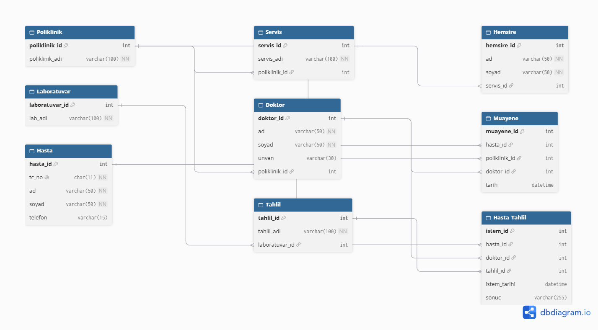

# 🏥 Veritabanı Yönetim Sistemleri - Ödev 1 (Hastane Otomasyonu)

> [!NOTE]
> Bu proje, Hastane Otomasyonu veri tabanı tasarımı için oluşturulmuş Varlık-İlişki (ER) şemasını, kural eşleme analizlerini ve çalışır T-SQL betiklerini içermektedir.

---

## 📌 Kural - Tablo Eşleme Analizi

1. **Kural 1 (Doktor - Poliklinik 1:N):** `Doktor` tablosuna `poliklinik_id` Foreign Key olarak eklenmiştir.
2. **Kural 2 (Hasta - Poliklinik N:M):** Çoka-çok ilişkiyi çözmek amacıyla `Muayene` ara tablosu oluşturulmuştur.
3. **Kural 3 (Hasta - Doktor - Tahlil N:M):** Tahlil istem süreci `Hasta_Tahlil` köprü tablosu üzerinden modellenmiştir.
4. **Kural 4 (Laboratuvar - Tahlil 1:N):** `Tahlil` tablosuna `laboratuvar_id` Foreign Key olarak eklenmiştir.
5. **Kural 5 (Servis - Hemşire 1:N):** `Hemsire` tablosuna `servis_id` Foreign Key olarak eklenmiştir.
6. **Kural 6 (Poliklinik - Servis 1:N):** `Servis` tablosuna `poliklinik_id` Foreign Key olarak eklenmiştir.

---

> [!IMPORTANT]
> ### 💡 Mimari Ek Kararlar
> - **Muayene Tablosu Doktor İlişkisi:** Ödev kuralı Hasta-Poliklinik arasında N:M ilişkisi tanımlasa da, muayene sürecini gerçek hayat senaryosuna uygun kılmak adına hangi doktorun muayene ettiğini takip edebilmek için `Muayene` tablosuna `doktor_id` alanı ek kararla eklenmiştir.
> - **Veri Verimliliği:** `Hasta.tc_no` alanı sabitleme ve indeksleme verimliliği açısından `CHAR(11)` olarak tanımlanmış ve `UNIQUE` kısıtı verilmiştir.

---

## 📐 Veritabanı Şeması

